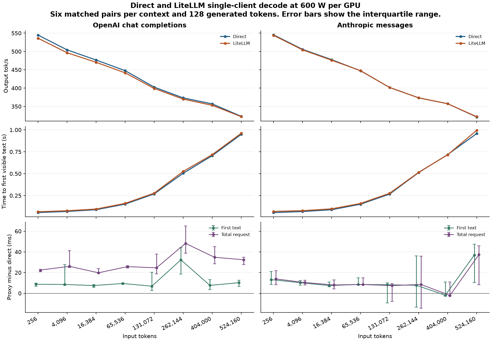
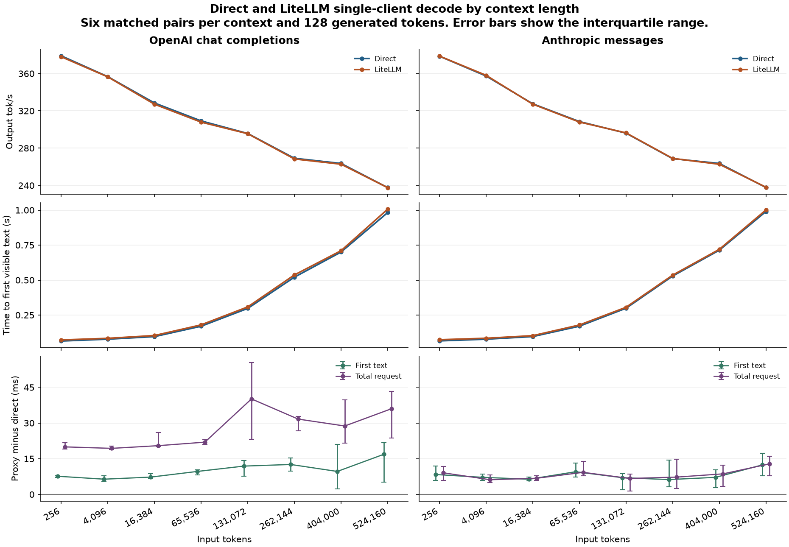

# Single-client decode throughput by context length

## 600 W GPU profile

The Rust/CUDA engine cleared 300 streamed output tok/s on every measured context on both routes and both API formats. At the 524,288-token window, OpenAI Chat delivered **322.9 tok/s direct and 322.0 through LiteLLM**. The request contained 524,160 input tokens and generated 128. Each row reports the median of six measured pairs. The largest difference between route medians was 1.57% on OpenAI Chat and 0.32% on Anthropic Messages. [All 224 requests, paired latencies and backend counters](results/c1-context-final-600w.jsonl)

| Input tokens | OpenAI direct | OpenAI via LiteLLM | Anthropic direct | Anthropic via LiteLLM |
|---:|---:|---:|---:|---:|
| 256 | 544.7 | 536.1 | 545.5 | 544.1 |
| 4,096 | 504.4 | 496.5 | 505.8 | 504.5 |
| 16,384 | 476.6 | 470.4 | 477.7 | 476.2 |
| 65,536 | 447.6 | 441.7 | 447.3 | 447.6 |
| 131,072 | 402.7 | 399.1 | 401.8 | 401.8 |
| 262,144 | 373.3 | 370.0 | 373.4 | 373.6 |
| 404,000 | 356.9 | 353.1 | 357.4 | 357.4 |
| 524,160 | 322.9 | 322.0 | 321.2 | 322.0 |


The clock starts at the first visible text and stops at the last, spanning 127 token intervals. The harness verified every 128-token receipt against its expected text, alternated the route order, restored matching prefixes and disabled LiteLLM response caching. At full context, the proxy added a paired median of 10.2 ms to first text and 32.4 ms to total latency on OpenAI Chat. On Anthropic Messages the corresponding differences were 37.0 and 37.4 ms. These medians include run-to-run differences in backend time. [Harness](tools/c1_proxy.py) · [GPU settings](results/benchmark-gpu-settings-600w.json)

The scheduler can draft from its own previously verified output while one client decodes. The receipt workload repeats codes and benefits from that policy. The original 1,500-token Python edit used default thinking and reached 278 tok/s at C1 on the same hardware. [Published workload comparison](UPSTREAM-COMPARISON.md)



## 375 W GPU control

The native Rust/CUDA engine and LiteLLM both cleared **300 output tok/s** through **65,536 input tokens** on this workload. The next measured size, 131,072 tokens, delivered about 296 tok/s on each route. At 524,160 input tokens, both delivered **238 tok/s**. Across eight warm context lengths and both API formats, the largest difference between direct and proxied median decode rates was **0.43%**. [Warm samples and backend counters](results/c1-overhead-warm.jsonl)

### Warm decode throughput

Values are streamed output tokens per second for one active client. Each column reports the median of six measured runs at that context length. Each run produced 128 visible tokens from a greedy receipt-retrieval prompt with reasoning disabled. The window includes the generated tokens. The separately measured new-code workload uses different prompts. [New-code benchmark](results/live-offload-c1-coding.jsonl)

| Input tokens | OpenAI direct | OpenAI via LiteLLM | Anthropic direct | Anthropic via LiteLLM |
|---:|---:|---:|---:|---:|
| 256 | 379.0 | 378.0 | 378.6 | 378.7 |
| 4,096 | 356.6 | 356.4 | 357.4 | 358.1 |
| 16,384 | 328.4 | 327.1 | 327.5 | 327.2 |
| 65,536 | 309.2 | 307.9 | 308.5 | 308.0 |
| 131,072 | 295.7 | 295.5 | 296.1 | 296.4 |
| 262,144 | 269.1 | 268.4 | 268.7 | 269.0 |
| 404,000 | 263.6 | 262.8 | 263.6 | 262.7 |
| 524,160 | 237.7 | 237.6 | 237.8 | 238.1 |



### Latency through LiteLLM

Each value below is the median of six paired differences in milliseconds. Positive numbers mean a longer wait through the proxy. At 524,160 input tokens the OpenAI route added 16.9 ms to the first visible text and 36.0 ms to stream completion. The Anthropic route added 12.4 ms and 12.8 ms. [Absolute timings and interquartile ranges](results/c1-overhead-summary.csv)

| Input tokens | OpenAI added first text (ms) | OpenAI added total (ms) | Anthropic added first text (ms) | Anthropic added total (ms) |
|---:|---:|---:|---:|---:|
| 256 | 7.6 | 20.0 | 8.4 | 9.1 |
| 4,096 | 6.4 | 19.4 | 7.2 | 6.2 |
| 16,384 | 7.3 | 20.5 | 6.4 | 6.8 |
| 65,536 | 9.7 | 22.0 | 9.5 | 9.3 |
| 131,072 | 11.9 | 40.1 | 7.0 | 6.7 |
| 262,144 | 12.6 | 31.7 | 6.2 | 7.3 |
| 404,000 | 9.7 | 28.7 | 7.2 | 8.6 |
| 524,160 | 16.9 | 36.0 | 12.4 | 12.8 |

For OpenAI Chat, the extra time *after the last visible text* also grew with prompt size, from 11.3 ms at 256 tokens to 19.3 ms at 524,160. That is the time until the client received the terminal SSE frame. For Anthropic Messages the paired median for this interval stayed within 0.02 ms of zero at each size. These are client-observed intervals. [Stream timings and paired samples](results/c1-overhead-warm.jsonl)

### Decode after a cold prompt

Each rate is the median of two measured runs after a warm-up pair. Both native prefix tiers were disabled and every request ingested the entire prompt. The model and OS page cache were warm. At 65,536 input tokens, cold ingestion took about 66 seconds on either route. Once output began, both routes still delivered over 306 tok/s. Small differences in first-token times include variation in ingestion time. [Cold samples and native execution counters](results/c1-overhead-cold.jsonl)

| Input tokens | OpenAI direct | OpenAI via LiteLLM | Anthropic direct | Anthropic via LiteLLM | OpenAI direct / proxy first text (s) |
|---:|---:|---:|---:|---:|---:|
| 4,096 | 356.5 | 355.3 | 357.5 | 355.3 | 3.762 / 3.770 |
| 16,384 | 326.9 | 324.9 | 326.3 | 326.7 | 15.190 / 15.198 |
| 65,536 | 307.9 | 306.4 | 307.5 | 307.9 | 66.154 / 66.307 |

### Measurement conditions

The test used the two RTX PRO 6000s at the workstation owner’s 375 W power limit, +450 MHz core and +4,000 MHz memory offsets. Each route opened a fresh local HTTP connection. Client timing began after JSON encoding and included request transfer, server work, proxy processing when applicable, and SSE delivery. Time to first text ended at the first visible content. Decode rate used 127 tokens divided by the interval from first to last visible text. Total latency ended at the terminal SSE frame. [Hardware profile](results/benchmark-gpu-settings.json) · [Benchmark harness](tools/c1_proxy.py)

The harness alternated which route ran first, excluded one warm-up pair per wire and length, and verified a native execution with zero concurrent work for every request. It checked input and output counts, expected receipts, termination reason and identical output hashes. Warm measured requests restored exactly the preceding 64-token chunk boundary. LiteLLM response-cache reads and writes were disabled. Both routes used the checkpoint’s own tokenizer counts. [Serving profile](results/serving-profile-3be9913.json)

The owner recalled a 180 W CPU limit throughout benchmarking. The Threadripper PRO 9965WX boot service specifies 180 W. On November 25, systemd skipped that service because of an ordering cycle. At 20:58 PST AMD HSMP reported a 225 W socket cap during the native benchmark session. Earlier timings have no simultaneous CPU-cap capture. [CPU configuration and kernel readback](results/benchmark-cpu-power.json)

## Reproduce the 600 W sweep or the 375 W control

Run from the engine repository with the native service, LiteLLM, and an existing API key available to the harness. The 600 W sweep used build `2ac7be5`, 64-token prefill chunks, `DS4_OUTPUT_LOOKUP=single`, `DS4_PREFILL_MX_TILES=4`, `DS4_VERIFY_MX_TILES=4`, `DS4_PARALLEL_PREFILL_ROUTER=1`, and `DS4_OVERLAP_PREFILL_ENGRAM=0`. It sent 224 warm-prefix requests including 32 warm-ups. The 375 W control used build `3be9913`. [375 W control settings](results/serving-profile-3be9913.json) · [600 W paired latency summary](results/c1-final-600w-summary.csv) The first command creates the six independent 404,000-token histories. The warm comparison uses the first history at 404,000 tokens and its verified continuation at 524,160.

```sh
uv run --with tokenizers==0.22.2 python tools/six_streams.py --seed 26611502719397 --input 404000 --output 128 --save-histories histories.json
uv run --with tokenizers==0.22.2 python tools/c1_proxy.py --wire both --histories histories.json > warm.jsonl
```

For the cold comparison, temporarily set the native service's prefix RAM and disk budgets to zero. These commands restore the normal Compose settings when the run exits. The 375 W control sent 260 generation requests across its warm and cold sweeps, including warm-ups. [Per-phase GPU settings](results/c1-hardware.jsonl)

```sh
(
  set -e
  trap 'docker compose --env-file ../models/.env up --no-build -d --wait' EXIT
  DS4_PREFIX_RAM_MIB=0 DS4_PREFIX_DISK_MIB=0 docker compose --env-file ../models/.env up --no-build -d --wait
  uv run --with tokenizers==0.22.2 python tools/c1_proxy.py --wire both --mode cold --contexts 4096 16384 65536 --pairs 2 > cold.jsonl
)
```
